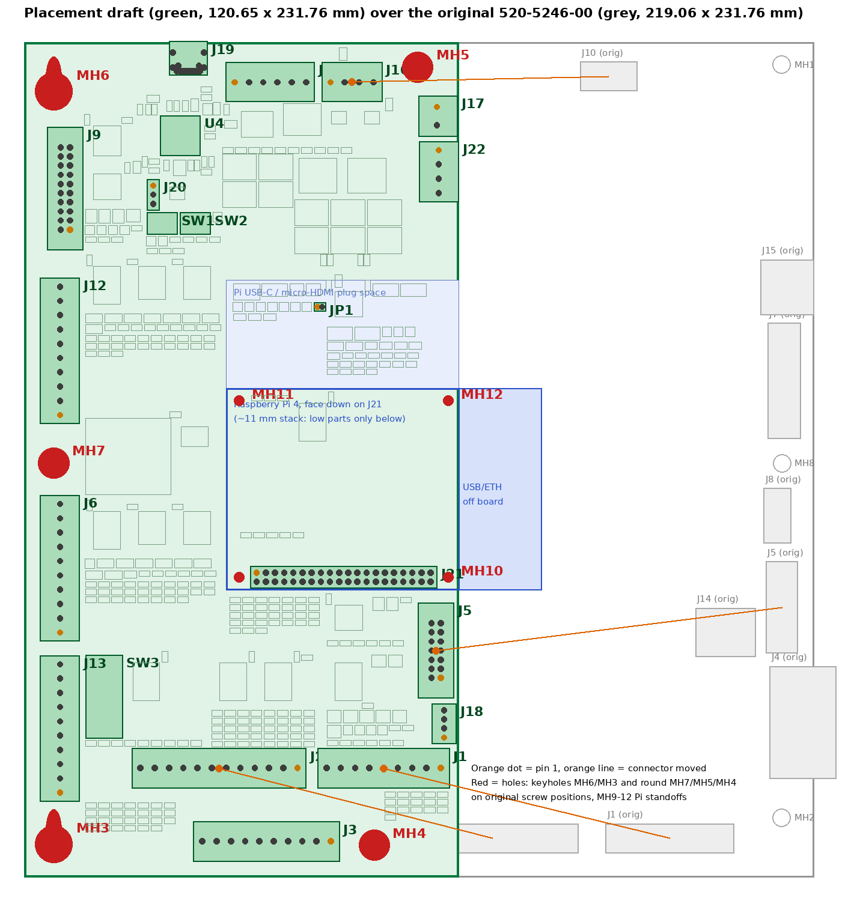

# PCB placement draft (0.6)

`sam_cpu/sam_cpu.kicad_pcb` has the board outline, the mounting holes, the connectors and a first placement of all
450 parts, on **4 copper layers**, partly routed (see Routing below). It matches the schematic (KiCad schematic parity: 0 footprint
errors) and has no courtyard overlaps.



`sam_cpu/pcb_overview.png` shows the new board over the original 520-5246-00 outline, with arrows for the
connectors that moved; it dates from draft 0.4 and still shows J5 and the 142 mm extension. `sam_cpu/pcb_render.png`
is KiCad's top render (draft 0.6).

Coordinates are millimetres from the top-left board corner, Y down, component side, as the board hangs in the
backbox (same frame as `docs/mechanical/`). KiCad's grid and drill origins are set to that corner.

## Outline

**120.65 x 236.76 mm**, 55 % of the original 219.06 mm width, widened to **142 mm from y 154 down** (below the Pi)
for the RS485 and line-in connectors. The left edge is unchanged; the bottom edge is 5 mm lower than the original
231.76 mm so the lowered MH3 keyhole fits (draft 0.7). (Draft 0.4 had the
same extension for the HUB75 headers; draft 0.6 removed it with the DMD; draft 0.7 brings it back for the RJ45s.) The width is set by three things: the Pi's USB/Ethernet end must hang past the right edge, the round
hole MH5 at X 109.2 is kept, and the J2 + J1 row needs about 88 mm. 4 copper layers.

## Mounting holes

All on original backbox screw positions (`docs/mechanical/README.md`):

| Hole | Type | Screw X, Y |
|---|---|---|
| MH6 | keyhole, opens upward, top-left | 8.24, 6.27 |
| MH3 | keyhole, opens upward, bottom-left (lowered 7.42 mm, draft 0.7) | 8.24, 222.59 |
| MH7 | round, left middle | 8.25, 116.84 |
| MH5 | round, top | 109.20, 6.98 |
| MH4 | round, bottom | 97.14, 222.86 |
| MH9-MH12 | M2.5, Raspberry Pi 4 standoffs | 59.65 / 117.65, 99.5 / 148.5 |

The original right-hand holes (MH1, MH8, MH2) fall outside the narrower board. The round holes use a 4.3 mm plated
pad (M4) until the real screw is measured.

## Connectors (pin 1 position)

| Conn | Function | Pin 1 X, Y | Original pin 1 | Change |
|---|---|---|---|---|
| J9 | IO bus 2x10 | 12.70, 52.07 | same | none |
| J12 | switch returns 9-16 | 10.03, 103.51 | same | none |
| J6 | switch returns 1-8 | 10.03, 163.83 | same | none |
| J13 | dedicated 17-24 | 10.03, 208.28 | same | none |
| J3 | dedicated in (upper) | 85.09, 221.73 | same | none |
| J2 | dedicated in (lower), 12 pin | 75.85, 201.41 | 151.77, 221.73 | 76 mm left, second row 20.3 mm up |
| J1 | switch strobes, 9 pin | 115.57, 201.41 | 194.94, 221.73 | 79 mm left, second row 20.3 mm up |
| J11 | power in | 58.41, 11.18 | same | none |
| J10 | speakers (now bridged: L+ R+ L- R-) | 85.00, 11.18 | 156.19, 8.76 | 71 mm left |
| J17 | external +5 V terminal, wires from the right edge | 114.5, 18.0 | new | |
| J23 | external +12 V terminal (audio), wires from the right edge | 114.5, 30.0 | new | |
| J22 | second speaker connector (L+ L- R+ R-) | 115.0, 41.5 | new | right edge |
| J24 | subwoofer (SUB1+ SUB1- SUB2+ SUB2-) | 115.0, 59.5 | new | right edge |
| J18 | GI dimmer header | 116.5, 193.0 | new | |
| J19 | USB-C to the Pi, on the top edge | centre X 45.6 | new | 13 mm from the RP2354B USB pins |
| J21 | Raspberry Pi 40-pin socket | 64.52, 147.23 | new | |
| J27 | RS485 in, side-entry RJ45 (CONNFLY DS1128-05-S8B8P), isolated, opening on the right edge | pin 1 155.10, 214.62 | new | extension (c27) |
| J29 | RS485 out, same, in parallel with J27 (optional) | pin 1 155.10, 230.52 | new | extension (c27) |
| J28 | I2S input from a remote Pi, 2x3 header | courtyard 105.4-111.6, 170.4-179.1 | new | below the RS485 resistors |
| J30 | line-in, switched 3.5 mm stereo jack (PJ-393-7A SMD, was CUI SJ1-3535NG), opening on the right edge | courtyard 105.8-124.9, 86.7-96.0 | new | right edge below J24, next to the amplifier inputs R187 / R190 |

The KK-396 headers keep the original orientation: pin 1 at the bottom of the left-edge connectors and at the right
end of the bottom ones, friction ramp toward the board centre. J3 stays in the bottom row; J2 and J1 form a second
row above it, keeping the left-to-right order J3 / J2 / J1 so the harness branches do not cross.

## Raspberry Pi 4

Assumed mounted **face down** on J21 (female 2x20 socket on this board), about 11 mm above the board, with its
USB/Ethernet end hanging past the right edge and its micro-SD card facing out. Under the Pi only low SMD parts
(under ~3 mm) can go. Its USB-C and micro-HDMI plugs point toward the top of the board; the area above the Pi is
for low parts only. If you prefer the Pi face up on a ribbon cable, J21 becomes a 2x20 box header and the
board could lose about 10 mm of width.

## Placement

- **RP2354B (U4)** sits at (44, 26), right next to the bus buffers and J9. The USB-C J19 is on the top edge
  above it: 13 mm from the connector's D+/D- pads to the chip's USB pins, so the USB pair can be routed short on
  2 layers without impedance control. The 27 R series resistors R13 / R14 sit just left of the regulator parts; the
  pair leaves pins 66 / 67 to the left, above pins 68-70.
- **Core regulator** (RP2350 hardware guide, Pico 2 layout, with 0805 capacitors): L1 straight above VREG_LX
  (1.8 mm), C12 4.7 uF on VREG_VIN on its left, C24 4.7 uF on the 1.1 V output on its right with its ground pad
  next to VREG_PGND, then the VREG_AVDD filter R8 / C11. Route LX, VIN, PGND and the 1.1 V output on the top layer
  with a solid ground under them, as the guide asks.
- Around U4, each 100 nF sits on its own IOVDD / DVDD pin, and the crystal with its load capacitors and 1 k sits on
  XIN / XOUT.
  Reset and BOOTSEL buttons, the SWD header J20 and the status LED are just below.
- Every other IC has its decoupling capacitor on its supply pin. The rest is grouped by schematic sheet next to its
  connector: power under J11 (power-path parts toward J17), bus buffers beside J9, switch inputs beside J12, J6,
  J13, J2/J3 and J1, audio under J10 next to J22 / J24.
- **Amplifiers**: U23 (stereo) and U24 (subwoofer) TDA7297 stand in a row at y 54-65 with their tabs toward the
  top edge, so one heatsink bar can take both. The area behind the tabs (59-107 x 41-54 mm) is kept free for it and
  marked on User.Drawings. The +12 V input J23, J22 and J24 are on the right edge next to them.
- The RTC and its CR2032 holder are at the left middle, reachable without removing the Pi.
- The Pi was moved down 12 mm to leave room for the audio parts above its plug area. Only low
  parts (SMD, no electrolytics or TO-220) are placed under the Pi and under its USB-C / micro-HDMI plugs.
- **RS485 / I2S / line-in** (draft 0.7): the isolated transceiver U32 (ADM2682E, SOIC-16W) sits below MH10 and
  straddles the isolation gap at x 114.5; its 1 k / pull resistors and VCC capacitors on the left (logic side), its
  isoPower capacitors, TVS D27, R211 and JP2 on the right. J27 / J29 are stacked in the extension. J30 sits on the right edge just below J24,
  next to the DAC and the 470 R amplifier inputs (Vincent: keep the line-in path short); R193 / R200 moved one row
  down for it (`c20_line_in_near_amps.py`). The cable side has its own GND_ISO zone on all four layers (x 116-142, y 154-181, then
  x 122-142 down to y 197.5); GND / +3V3 stay 2 mm away. Keep every non-isolated track out of that area.
- **RP2354B fan-out** (draft 0.7, Vincent's review): the bus buffers U6 / U7 were turned with their RP2354B side away
  from U4, so every bus line had to go around its buffer. Both are now turned 180 degrees in place with their channel
  order reversed on the IO bus sheet (`c21`), which keeps the bit order on U4 and on J9; their J9 side now faces J9.
  R13 / R14 swapped so the USB pair leaves U4 without crossing. The RP-side RS485 resistors R205 / R207 / R209 moved
  next to U4 (column between U7 and J20, x 31.4-33.0). The bus, USB and RS485 nets were ripped for re-routing
  (`c22_board_rp_fanout.py`). BUS_DIR and BUS_OE_N still cross the address lines (fixed pins on both sides): one via
  each.
- **MH3** (draft 0.7): Vincent saw the bottom-left keyhole sat too high. On the Stern drawing the top keyholes' screw
  positions are level with the top round hole MH5, but the bottom ones are 7.4 mm (one slide) above the bottom round
  hole MH4. MH3's screw position moved down 7.42 mm to y 222.59 (0.27 mm from MH4's row); its clearance circle would
  cross the bottom edge there, so it is an open notch in the outline. U31 (595) sits by J1, U30
  (165) under J6 at the end of the switch chain.
- This is a first pass made by a script: expect to tighten the U4 area, rotate parts for routing, and spread the
  dense resistor blocks once routing starts.

## Checks

- `kicad-cli pcb drc --schematic-parity` (KiCad 10.0.6): every schematic part has its footprint with matching nets
  (no missing, extra or net-conflict reports), no courtyard overlaps, no shorts, no hole clearance issues. The
  remaining reports are expected before routing: unconnected pads, silkscreen overlaps, the keyhole footprints
  coming from an in-board library, and footprint field differences (Description / Datasheet / MPN text and the
  BOM flag), which "Update PCB from Schematic" fills in.

## To confirm

- The measurements listed in `docs/mechanical/README.md` (board size, KK pin row from the edge, screws in the round
  holes and their diameter).
- Pi orientation (face down on the socket, or face up on a ribbon).
- The heatsink for U23 / U24 (size and how it is fixed) and the speaker impedances.
- Harness reach for J1, J2 and J10 at their new positions, and that J10's two speaker returns are separate wires.

## How it was generated

The two-panel change (draft 0.4) was applied in place by `tools/changes/c04_board_update.py`: pad nets updated (52)
and 20 new footprints placed, with no existing footprint moved. Earlier drafts came from:

```
kicad-cli sch export netlist -o /tmp/sam_cpu.net sam_cpu/sam_cpu.kicad_sch
python3 tools/place_pcb.py /tmp/sam_cpu.net sam_cpu/sam_cpu.kicad_pcb      # KiCad 10's Python (import pcbnew)
python3 tools/pcb_dump.py sam_cpu/sam_cpu.kicad_pcb /tmp/fp.json           # KiCad 10's Python
python3 tools/pcb_overview.py /tmp/fp.json <docs/mechanical positions CSV> sam_cpu/pcb_overview.png
```

Do not rerun `place_pcb.py`: it overwrites the board. Edit in KiCad or with a new change script.

Draft 0.6 (2026-10-07), also in place: `c12_board_remove_dmd.py` deletes the 28 DMD footprints, their tracks and
the ground / power stubs that served only them, frees RP2354B GPIO20-36 and restores the 120.65 mm outline;
`c15_board_rs485_i2s.py` updates 6 pad nets and places the 15 RS485 / I2S parts (no existing part moved), ripping
the unlocked tracks that crossed their courtyards. Draft 0.7: `c18_board_isolated_rs485.py` restores the extension,
moves MH3, replaces the page-13 parts (22 now: ADM2682E, J29, J30 and C128-C132 added) and adds the GND_ISO zone;
it ripped 66 tracks / vias on 6 nets (the old DAC output nets, now split through J30, and tracks under J28) plus 39
stubs left dangling.

## Routing (draft 0.5)

- **4 copper layers** (Vincent, 2026-10-07): F.Cu signals, In1.Cu solid GND plane, In2.Cu +3V3 plane, B.Cu signals.
  GND pours on both outer layers. Two-layer autoroutes stalled at 39-170 open connections.
- Rules (JLCPCB): 0.2 mm tracks / 0.15 mm clearance, 0.1 mm minimum for pad neck-downs, 0.6 / 0.3 mm vias.
  Net classes: Power 0.25 mm (+3V3, +4V5, +1V1, VREF), Power_5V 0.5 mm, Power_HI 0.8 mm (+12 V and the input paths),
  Speaker 1.0 mm.
- Hand-routed and locked: the RP2354B core regulator (short LX loop, VIN cap, PGND into the exposed pad, FB on the
  1.1 V rail) and a 1.5 mm +5 V trunk from the power mux under the Pi to J21 pins 2 / 4.
- Every SMD GND and +3V3 pad has its own via to its plane; 9 vias in the RP2354B exposed pad.
- The rest is Freerouting 2.5 output (`tools/changes/route/`), not cleaned up: expect meanders and extra vias.
  Draft 0.5 left 35 connections open; removing the DMD interfaces (draft 0.6) took that to 20.
- **Draft 0.7 routing (cloud, 2026-10-07/08):** 37 connections open (DRC unconnected items; 124 at the start), no
  clearance or short errors. The isolated RS485 side is routed on its own and no other net has copper inside the
  GND_ISO area (`route/isochk.py`). New RS485 parts got plane vias (`route/fanout_missing.py`); the routing jammed
  around the RP2354B was ripped (`route/ripreg.py`) and re-routed in 3-pass chunks.
- **USB pair** (`tools/changes/c23_usb_bus_room.py`, Vincent: "Move parts, reroute"): U4 pins 66 / 67 were fenced in
  by pin 64's +3V3 fan-out track and C12. C12 moved 1.6 mm left, pin 64 got its own via inside the pin row, R13 / R14
  moved between J19 and C12 / L1 (R14 D+ left, R13 D- right), and the pair is hand-routed and locked from the pins
  straight up to them; it passes 0.4 mm from L1's switching pad for about 2.5 mm. U7 moved 1.8 mm right and 1 mm down
  to open a lane between J9 and U7 for the BD lines.
- **JLCPCB rules:** `sam_cpu/sam_cpu.kicad_dru` (4-layer set from the project's jlcpcb_rules notes). DRC with it:
  no errors from tracks, vias or holes except the keyhole slots MH3 / MH6 (10.4 / 11.8 mm, over the 6.3 mm drill
  limit; JLCPCB mills them) and 7 starved thermals on GND pads. `route/via_spacing.py` pushes apart vias of
  different nets closer than 0.5 mm hole to hole (5 pairs left, warnings, in tight spots), `route/edge_nudge.py`
  keeps the J10 speaker track 0.3 mm from the edge.
- Still open: BOOTSEL, about 12 bus lines between U4, U6 / U7 and RN1-RN3, XOUT to R16, a few long runs (STB_DATA,
  SW_*, FRAME_CS_N, AMP_MUTE, GI_PWM, Pi SWCLK, the RS485 TXD), +5 V / +12 V segments (around U6 / U7 and the
  amplifiers), AUD_DAC_L / R, and one GND_ISO pour island.
- Steps: `tools/changes/c05_layout_setup.py` (rules, classes, hand routes), `c07_gnd_fanout.py`, `c08_four_layers.py`,
  `c09_plane_fanout.py`, then export the DSN (`route/export4.py`), `route/mkiso.py r.dsn rA.dsn A` (isolated area as
  keepout, iso nets in class ISO), `route/chunk2.sh rA.dsn rA.ses 3 --router.autorouter.ignore_net_classes=ISO`, and
  import with `route/imp2.py` (keeps the zones). The isolated nets: `route/mkisoB.py`, Freerouting, `route/impiso.py`.

## Stock-driven part swaps (2026-10-16)

Vincent asked to replace parts JLCPCB does not stock or that are not recommended for new designs. Each step is a
script in `tools/changes/`, applied on top of b08cf77 in this order:

- `c24_u32_ca_is2092vw_sch.py` / `c25_board_u32_ca_is2092vw.py`: U32 ADM2682E -> Chipanalog CA-IS2092VW (C7422559),
  same SOIC-16W, different pinout (schematic symbol `sam_cpu:CA-IS2092VW` in `sam_cpu.kicad_sym`). SEL floats, so
  VISO is 3.3 V; Y/Z are gone (half duplex A/B only). Logic-side fan-out re-netted; cable side rerouted.
- `c26_board_bt1_xdcr2032.py`: BT1 Keystone 3034 -> Lianxin XDCR-2032-603 SMD CR2032 holder (C7498148), same centre.
  BT1+ rerouted to U25 pin 6 (`route/mkonly.py`, Freerouting, `route/imponly.py`).
- `c27_board_rj45_side_entry.py`: J27/J29 OST PJ012 vertical -> CONNFLY DS1128-05-S8B8P side entry (C86577), both
  opening on the right edge below D27. The GND_ISO area now reaches y 235 and GND / +3V3 start at y 237.
- Isolated side rerouted with `route/mkonly.py` (A, B, VISO, GND_ISO; the non-isolated side is a keepout polygon),
  then `route/fanout_vias.py ... GND_ISO U32:9 U32:15 C130:2 C131:2 C132:2 D27:3` for plane vias.
- `c28_fp_library.py`: project footprint library `sam_cpu.pretty` + `fp-lib-table` for the BT1 and RJ45 footprints,
  schematic Footprint fields updated, U32 logic nets renamed to the new pin names (RO / DI).
- Result: 36 unconnected items (none on the isolated side), schematic parity as before, ERC clean.
- U6 SN74LVC8T245 and U25 DS3231MZ stay: U6 has 40k in stock and its 5 V B side rules out the newer AXC parts;
  U25 has the most stock of any temperature-compensated RTC at JLCPCB (3,115).
- `c29_board_c108_c118_35v_8x10.py`: C108 / C118 470 uF on +12 V -> 35 V 8x10 can (RV35V470M8X10, C48935389),
  Vincent's card choice; +12V feed rebuilt at y 68.6, GND pads fanned out with `route/fanout_vias.py`.
- `c30_dip_switch_dnp.py`: SW3, R168-R175, U14 and C93 marked DNP (not loaded) in the schematic and on the board.
- `c31_sch_bigger_text.py`: schematic text 1.27 -> 1.6 mm.
- `c32_j19_j30_stocked.py`: J19 HRO TYPE-C-31-M-12 -> SHOU HAN SH-U262-161N-4BVC11 (C22383468, same pattern, rear
  shell slots 1.4 mm); J30 CUI SJ1-3535NG -> PJ-393-7A SMD switched stereo jack (C128990), footprint from the maker's
  drawing, 0.2 mm lower so it clears R186. +12V passes under it on B.Cu, I2S_DIN / FRAME_SCK / AUD_AMP_L/R /
  AUD_DAC_L hand-routed around its pads, then `route/fanout_vias.py ... GND J30:S`. Both footprints are in
  `sam_cpu.pretty`. Check the tip / ring pins (4 / 3 per the drawing) against a sample before ordering in quantity.
- Result after c32: still 36 unconnected items, no new DRC errors, schematic parity as before.
- `c33_power_mux_tps2117_sch.py` / `c34_board_power_mux_tps2117.py`: power mux U1 / U2 (LTC4412, only a 77-piece
  clone in stock) + Q1 / Q2 -> one TI TPS2117DRLR (C22399676, SOT-583-8), Vincent's card choice. Priority mode: VIN1 =
  external +5 V (J17, net EXT_5V, MODE tied to it), VIN2 = J11 +5 V after JP1 (J11_5V); R1 100k / R2 33k on PR1 keep
  VIN1 selected above about 4 V. U1 sits in the old Q1 / Q2 spot at (99.75, 103.85); R1 (now 0402) stands between F1
  and the EXT_5V track, R2 east of U1, PR1 crosses under U1 on B.Cu. EXT_5V / J11_5V move to the Power_5V class
  (0.2 mm, for the 0.5 mm pitch pins). Result: 36 unconnected items, no new DRC errors, parity as before, ERC clean.

### Second alternative (branch claude/project-thread-ij88aa, 2026-10-17)

Same RP2354B-on-board design and stack-up (F signal, In1 GND, In2 +3V3, B signal), with parts taken out to free
routing space (Vincent's choices):
- `c35_sch_trim_usb_gi_dip_swd.py` / `c36_board_trim_usb_gi_dip_swd.py`: USB-C J19 with R10-R14, the GI dimmer
  sheet (J18, R183-R185), the J20 SWD header and the DIP block (SW3, R168-R175, C93, U14) are removed. The Pi flashes
  the RP2354B over SWD on J21 pin 18 GPIO24 = SWDIO and pin 22 GPIO25 = SWCLK, as Raspberry Pi OpenOCD's
  `interface/raspberrypi-swd.cfg` (`adapter gpio swdio 24`, `swclk 25`); a blank RP2354B flashes over SWD. U15's
  serial input goes to GND, so the switch chain is 8 bits shorter (firmware: 48 bits, no DIP byte).
- `c37_board_bus_arrays_by_j9.py`: RN1-RN3 and TP10-TP13 moved next to J9 (`movelib.py` moves named parts only).
- All unlocked copper re-routed with Freerouting 2.5.0 in chunks, then hand fixes (EXT_5V under U1).
- Result: 18 unconnected items (baseline 36), no DRC errors apart from starved thermals, schematic parity clean,
  ERC clean. Still open:
  - U4 left-side escape to U6 / U7: BUS_A0, BUS_A1, BUS_D0, BUS_D1, BUS_D6, SW_CLK, SW_LOAD_N, BOOTSEL (8).
    The +3V3 plane vias of U4 pins 5 and 76 and the inner +1V1 ring block these lanes.
  - Power fragments: +5V (C6-C33, U1 VOUT / TP1, near R197) 4, +12V (C3, R197) 2.
  - D18-A, D21-A, and 2 GND_ISO zone islands.
- USB-C back as a backup flashing path (2026-10-18, Vincent: "start from a board with USB-C fitted ... placement
  only, DeepPCB routes it"): `c38_sch_restore_usb.py` restores J19 and R10-R14 on the MCU sheet as at e6c37a8 and
  names the pair USB_D+ / USB_D- (U4 to R13 / R14) and USB_C_D+ / USB_C_D- (R13 / R14 to J19).
  `c39_board_restore_usb.py` places J19, R13, R14 at their e6c37a8 spots (top edge above U4) and R10-R12 in a column
  left of J19 (their old spot is now D3 / SW2), 1 mm or more between courtyards, unrouted. Netclass USB: 0.2 mm
  tracks, 0.15 mm gap differential pair (about 90 ohm on F.Cu over In1 with the JLC04161H-7628 stack; check with
  JLCPCB's calculator), plus a `sam_cpu.kicad_dru` rule (gap 0.13-0.2 mm, 3 mm uncoupled, 0.5 mm skew). The J20 SWD
  header, the GI dimmer and the DIP block stay removed; SW1 RESET and SW2 BOOTSEL were never removed.
  Result: 28 unconnected items (the 18 above + 10 for USB-C), no new DRC errors, ERC clean.
- DeepPCB dropped U4 pins 66 / 67 as unreachable (a coupled 0.2 / 0.15 mm pair can't leave a 0.4 mm pitch QFN).
  `c40_board_usb_pin_escape.py` removes the unlocked +1V1 stub from pin 65 to L1 that ran beside pin 66 (pin 65
  keeps the locked inner ring; L1 / C24 are now one +1V1 open for the router). `c41_board_usb_pair_from_e6c37a8.py`
  brings back the hand-routed, locked USB pair of e6c37a8 (U4 to R13 / R14 to J19), renamed to the c38 nets. USB is
  full speed only on the RP2354B, so the class is 0.2 mm tracks with 0.2 mm gap (the pin pitch, about 100 ohm), clearance
  0.15 mm, and the rule allows 8 mm uncoupled and 2 mm skew per pair. Result: 23 unconnected items, the pair complete.
- Clean +12 V rail and Pi 5 V (2026-10-27, Vincent: a clean 12 V rail, then "le pont pour l'alim 5V en cas
  d'utilisation d'un Jetson", option A: before the DeepPCB run). `c42_sch_12v_or_pi_buck.py` (power sheet):
  J23 (EXT_12V) and J11 pin 6 (IO_12V, the IO board's 12 V, unused so far) feed an ideal-diode OR, one LTC4412
  (U33 / U34, TSOT-23-6, C514442) and one P-FET DMP3013SFV (Q19 / Q20, PowerDI3333, 30 V 11 mOhm) per input, into F1
  and the +12V rail. EXT_12V has priority: R213 47k / R214 10k pull U34 CTL high and turn the J11 path off while
  J23 is above about 5 V (CTL above 0.9 V). The Pi gets its own buck: U35 TPS54302 (C311983), L2 10 uH FXL0630, 2 x 22 uF out,
  R215 100k / R216 13k for 5.18 V, on PI_5V_BUCK. JP3, a 3-pin header with one jumper shunt, picks the Pi header 5 V
  (PI_5V, J21 pins 2 and 4, on the middle pin): 1-2 for the board +5 V as before, 2-3 for a Pi 4 / Pi 5 from the buck,
  no shunt for a Jetson or a Pi powered on its own USB-C. One shunt cannot join both sources. The header is a
  right-angle 1x3 2.54 mm PZ254R-11-03P (LCSC C492411, shunt C100114, about 3 A), about 2.5 mm high so it fits the
  Pi area keep-low limit; the Pi has to come off to move the shunt (c46 / c47; c42 / c43 first had two solder
  jumpers JP3 / JP4, which could both be bridged, then c44 / c45 one three-pad solder jumper). The MCU sheet's +5V symbol on J21 becomes the PI_5V label.
  `c43_board_12v_or_pi_buck.py` (board): the OR sits by J23 (raw x 124.6-137.3, y 49.5-61.4), the buck under the
  Pi at x 127-136.4, y 127-157 (L2 is 3.0 mm high: the Pi area keep-low limit), JP3 lies below the buck, pads on y 159.5 (pin 1
  +5V at x 135.29, pin 2 PI_5V at 132.75, pin 3 PI_5V_BUCK at 130.21, pins and shunt toward +y): the +5V trunk to
  J21 is cut on x 109 between y 155.3 and 157.3, and two B.Cu tracks (+5V on y 155.3, PI_5V on y 157.3) join it to
  pins 1 and 2 through short F.Cu tails; the buck output bus on x 131.275 runs on into pin 3. No new part inside the DeepPCB cut. All their copper is hand-routed (no router),
  net classes Power_12V 0.8 mm / 0.2 mm (the PowerDI3333 gate pad is 0.23 mm from a source pad) and Power_PI 1.2 mm.
  Result: 23 unconnected items as before, no new DRC errors, schematic parity unchanged.
- DeepPCB revision 44 of the v6 cut (2026-10-27, unfinished 30 min run), taken net by net (`tools/changes/route/take_nets.py`):
  each net DeepPCB closed and we had open was tried alone on this board and kept only when the DRC errors did not
  grow. Kept: J19 CC1, CC2 and VBUS (A4). Skipped, each colliding with our copper (6 to 43 errors): D21-A, SW_CLK,
  SW_LOAD_N, BUS_A1, BUS_D1, BUS_D6, +1V1, +12V, +5V. Result: 19 unconnected items (23 before), no new DRC errors.
